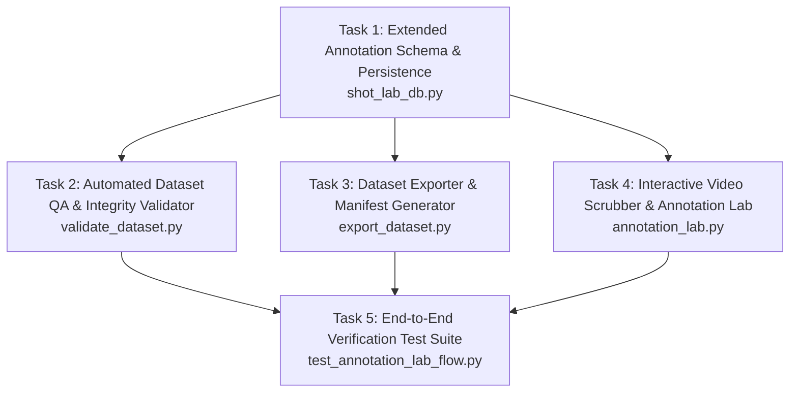

# Phase 5 — Developer Model Lab and Annotation Dataset

**Status:** Ready for Execution (Context locked in `05-CONTEXT.md`)  
**Goal:** Build an internal, developer-facing video scrubber, persistence schema, dual-lane timeline, QA validator, and manifest-driven exporter to create verifiable, auditable training and evaluation datasets for downstream models.

---

## 1. Executive Summary & Architecture Principles

1. **Internal Developer Tooling Boundary:** This phase delivers the internal data labeling product and dataset curation pipeline, **not** the end-user app.
2. **Clear Division of Labor:**
   - **Manual Developer Work:** Supply permitted video files, record capture metadata and consent, mark/verify event boundaries and outcomes, label hard negatives, and approve train/val/test splits.
   - **Coding-Agent Work:** Build the OpenCV frame scrubber (`annotation_lab.py`), SQLite persistence (`shot_lab_db.py`), QA validator (`validate_dataset.py`), manifest exporter (`export_dataset.py`), and test suites.
3. **Dual-Lane Provenance Separation:** Machine detector proposals (Cyan lane) are displayed side-by-side with human annotations (Amber lane). Machine proposals remain strictly immutable and are never overwritten or conflated with ground truth.
4. **Comprehensive 8-Class Negative Action Taxonomy:** Explicitly label non-shot intervals to train models against false triggers: `dribble_drive`, `gather_no_shot`, `pass`, `pump_fake`, `rebound`, `defensive_contest`, `catch_and_hold`, and `idle_reset`.
5. **Strict Data Integrity (AGENTS.md):**
   - Splits (`train`, `val`, `test`) partition strictly by **player and recording session**, never across adjacent frames of the same clip.
   - Missing videos fail fast with exact file paths and retrieval commands; never substitute mock/synthetic data.
   - Synthetic fixtures are strictly isolated in tests and labeled `synthetic: true`.

---

## 2. Work Breakdown & Task Sequence

---

### Task 1: Extended Annotation Schema & Persistence (`shot_lab_db.py`)
- **Objective:** Extend `ShotLabDB` (Schema v3) to persist video clip metadata, dual-lane machine proposals, and human ground-truth annotations with 8-class negative taxonomy.
- **Files to modify:** `shot_lab_db.py`, `test_annotation_db.py`
- **Schema Details (`schema_version = 3`):**
  - `labeled_clips`:
    - `clip_id TEXT PRIMARY KEY`, `file_path TEXT NOT NULL`, `file_sha256 TEXT`, `player_id TEXT NOT NULL`, `camera_view TEXT NOT NULL` (`side_90 | oblique_45 | frontal`), `shot_style TEXT DEFAULT 'jump_shot'`, `fps REAL`, `frame_count INT`, `width INT`, `height INT`, `split TEXT DEFAULT 'train'` (`train | val | test`), `license TEXT DEFAULT 'private_project'`, `created_at TIMESTAMP`.
  - `machine_proposals`:
    - `proposal_id TEXT PRIMARY KEY`, `clip_id TEXT NOT NULL`, `detector_name TEXT NOT NULL`, `detector_version TEXT NOT NULL`, `start_frame INT`, `end_frame INT`, `dip_frame INT`, `set_frame INT`, `release_frame INT`, `confidence REAL`, `status TEXT DEFAULT 'proposed'` (`proposed | accepted | discarded`), `created_at TIMESTAMP`, `FOREIGN KEY (clip_id) REFERENCES labeled_clips(clip_id)`.
  - `labeled_intervals`:
    - `interval_id TEXT PRIMARY KEY`, `clip_id TEXT NOT NULL`, `interval_type TEXT NOT NULL` (`shot | hard_negative`), `action_class TEXT NOT NULL` (`shot_event` or one of 8 negative classes), `start_frame INT NOT NULL`, `end_frame INT NOT NULL`, `dip_frame INT`, `set_frame INT`, `release_frame INT`, `follow_through_frame INT`, `outcome TEXT` (`make | miss | unknown | none`), `rim_contact TEXT`, `occluded_lower BOOLEAN DEFAULT 0`, `occluded_upper BOOLEAN DEFAULT 0`, `annotator_id TEXT DEFAULT 'human_reviewer'`, `review_status TEXT DEFAULT 'verified'` (`draft | verified`), `notes TEXT`, `created_at TIMESTAMP`, `updated_at TIMESTAMP`, `FOREIGN KEY (clip_id) REFERENCES labeled_clips(clip_id)`.
- **Database Methods to Implement:**
  - `register_labeled_clip(clip_data: Dict[str, Any]) -> str`
  - `get_labeled_clip(clip_id: str) -> Optional[Dict[str, Any]]`
  - `list_labeled_clips(split: Optional[str] = None) -> List[Dict[str, Any]]`
  - `save_machine_proposals(clip_id: str, proposals: List[Dict[str, Any]], detector_name: str, detector_version: str) -> int`
  - `get_machine_proposals(clip_id: str) -> List[Dict[str, Any]]`
  - `update_machine_proposal_status(proposal_id: str, status: str) -> bool`
  - `save_labeled_interval(interval_data: Dict[str, Any]) -> str`
  - `update_labeled_interval(interval_id: str, updates: Dict[str, Any]) -> bool`
  - `delete_labeled_interval(interval_id: str) -> bool`
  - `get_clip_annotations(clip_id: str) -> Dict[str, Any]` (combines clip metadata, machine proposals, and human intervals).
- **Verification:** Unit tests in `test_annotation_db.py` verifying v3 table migration, clip registration, proposal ingestion, interval CRUD, and dual-lane isolation.

---

### Task 2: Automated Dataset QA & Integrity Validator (`validate_dataset.py`)
- **Objective:** Build an automated dataset validation engine enforcing chronological bounds, taxonomy validity, split isolation, and AGENTS.md missing-file fail-fast checks.
- **Files to create:** `validate_dataset.py`, `test_validate_dataset.py`
- **Validation Rules & Error Checks:**
  1. `ERR_BOUNDS`: Ensures $0 \le start\_frame \le end\_frame < frame\_count$.
  2. `ERR_TEMPORAL_ORDER`: For shots, ensures $start \le dip \le set \le release \le follow\_through \le end$.
  3. `ERR_TAXONOMY`: Ensures `action_class` is either `shot_event` or one of the 8 approved negative classes (`dribble_drive`, `gather_no_shot`, `pass`, `pump_fake`, `rebound`, `defensive_contest`, `catch_and_hold`, `idle_reset`).
  4. `ERR_OUTCOME_COHERENCE`: Shots must have outcome (`make | miss | unknown`); hard negatives must have `outcome == "none"`.
  5. `ERR_SPLIT_LEAKAGE`: Enforces $Set(Players_{train}) \cap Set(Players_{test}) = \emptyset$ and $Set(Players_{val}) \cap Set(Players_{test}) = \emptyset$.
  6. `ERR_MISSING_VIDEO`: Checks whether the referenced video path exists locally. If missing, stops immediately, displays the missing path, and outputs the exact directory/command required.
  7. `WARN_OVERLAPPING_INTERVALS`: Flags overlapping intervals for the same player.
- **CLI & Reporting:** Emits a structured JSON report and human-readable summary detailing pass/fail status, total clips, frame coverage, and class distribution.
- **Verification:** Unit tests in `test_validate_dataset.py` testing each rule against valid fixtures and synthetic negative fixtures (marked `synthetic: true`).

---

### Task 3: Dataset Exporter & Manifest Generator (`export_dataset.py`)
- **Objective:** Create a manifest-driven export tool to package verified annotations into machine-readable JSONL datasets with SHA256 checksums and split isolation.
- **Files to create:** `export_dataset.py`, `test_export_dataset.py`
- **Specification:**
  - Generates `DATASET_MANIFEST.json` containing:
    - Dataset metadata: version, timestamp, license, total clips, total frames.
    - Class distribution: count of shots (`made`, `missed`, `unknown`) and negative intervals per class.
    - File catalog: per-clip ID, relative path, SHA256 checksum, player ID, camera view, FPS, split.
  - Generates split JSONL files: `exports/train.jsonl`, `exports/val.jsonl`, `exports/test.jsonl`.
  - Each line contains a complete clip record with separate `machine_proposals` and `human_annotations`.
  - Flags: `--db`, `--out-dir`, `--include-drafts`, `--verify-checksums`.
- **Verification:** Unit tests in `test_export_dataset.py` verifying file generation, SHA256 consistency, and JSONL format.

---

### Task 4: Interactive Video Scrubber & Annotation Lab (`annotation_lab.py`)
- **Objective:** Deliver a high-performance OpenCV HighGUI desktop tool for video inspection, timeline scrubbing, proposal review, and interval marking.
- **Files to create:** `annotation_lab.py`
- **UI & Interaction Design:**
  - Native OpenCV window (`cv2.imshow`) rendering:
    - Video viewport with frame number, timecode, player/view info, and active interval status.
    - Dual-lane timeline overlay at the bottom:
      - **Top Lane (Cyan):** Machine proposals (`dip`, `release`).
      - **Bottom Lane (Amber):** Human ground-truth intervals (color-coded by outcome/class).
    - Scrub bar trackbar (`cv2.createTrackbar`) for seeking.
  - Keyboard Controls:
    - `Space`: Toggle Play / Pause.
    - `,` / `.`: Step $\mp 1$ frame.
    - `<` / `>`: Step $\mp 10$ frames.
    - `[` / `]`: Mark interval start / end frame.
    - `S`: Commit marked interval as Shot Event (prompts for dip/set/release and outcome M/X/U).
    - `N`: Commit marked interval as Hard Negative (displays 1–8 taxonomy selector).
    - `A`: Accept active machine proposal into human lane.
    - `D`: Discard active machine proposal.
    - `U`: Undo last human annotation.
    - `R`: Run/refresh detector on clip to populate machine proposals.
    - `Q`: Save annotations and exit.
  - Headless/CLI mode (`--headless`, `--summary`, `--auto-detect`) for test automation and scripting.
- **Verification:** Script execution on sample clip fixture verifying frame seeking, hotkey handling, and database updates.

---

### Task 5: End-to-End Verification Test Suite (`test_annotation_lab_flow.py`)
- **Objective:** Comprehensive integration test verifying the entire Developer Model Lab lifecycle.
- **Files to create:** `test_annotation_lab_flow.py`
- **Verification Steps:**
  1. Register video clip with metadata and SHA256 hashing.
  2. Ingest machine proposals and verify immutability.
  3. Accept proposal into human lane and nudge boundaries.
  4. Mark negative intervals across the 8-class taxonomy.
  5. Run QA validator and verify zero errors on clean dataset.
  6. Trigger QA validator errors (e.g. artificial inverted boundary, split leakage) and confirm clear rejection.
  7. Export manifest and JSONL splits, verifying SHA256 checksums and split isolation.
  8. Confirm missing video file triggers fail-fast error with retrieval instructions.

---

## 3. Acceptance Gates for Phase 5 Completion

1. **Schema & Database Integrity:** Versioned SQLite migration v3 passes with full CRUD for clips, proposals, and intervals.
2. **Interactive Tool Usability:** `annotation_lab.py` runs smoothly on real video clips, enables bi-directional frame scrubbing, dual-lane visual inspection, and saves annotations without crashing.
3. **8-Class Negative Coverage:** All 8 hard-negative classes can be marked, validated, and exported.
4. **Validation Pass:** `validate_dataset.py` catches all boundary errors, split leaks, and missing files with zero false passes.
5. **Export Reproducibility:** `export_dataset.py` produces validated `DATASET_MANIFEST.json` and JSONL files matching project data integrity contracts.
6. **Full Test Suite Passing:** All new unit and integration tests (`test_annotation_db.py`, `test_validate_dataset.py`, `test_export_dataset.py`, `test_annotation_lab_flow.py`) pass alongside existing Phase 1–4 tests.
