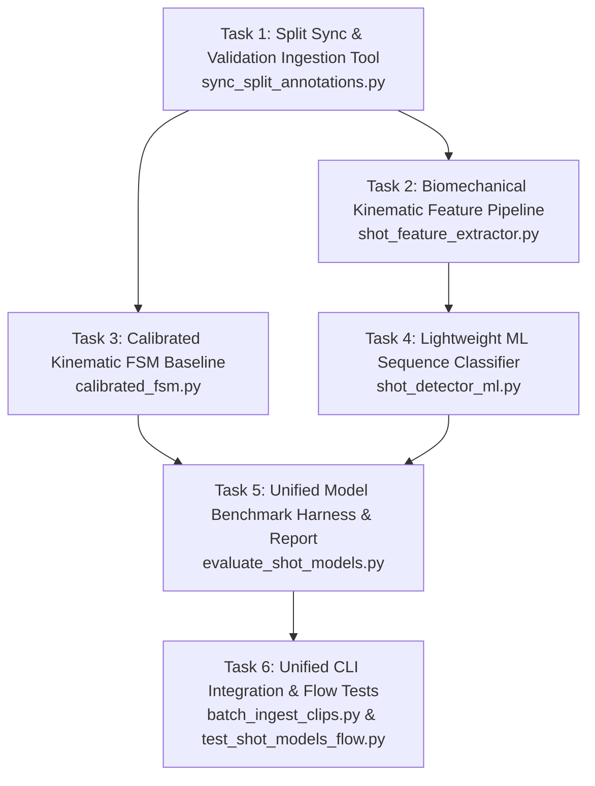

# Phase 6 — Shot-Event Model and Verification: Implementation Plan

**Status:** Ready for Execution (Context locked in `06-CONTEXT.md`)  
**Goal:** Improve basketball shot proposal detection and keyframe event timing (`start`, `dip`, `set`, `release`, `follow_through`) using verified ground-truth labels from Phase 5, with measurable, reproducible improvements over the existing heuristic baseline (`ShotPhaseDetector`).

---

## 1. Executive Summary & Architectural Decisions

1. **Strict Phase Boundary:**
   - Focus is exclusively on shot event detection, keyframe timing precision, negative action rejection, and held-out validation.
   - Ball and rim tracking / trajectory fitting is strictly deferred to **Phase 7**.
   - End-user UI / mobile upload workflow is strictly deferred to **Phase 8**.
2. **Two-Tier Model Architecture (Decision 1):**
   - **Tier 1 (Core Baselines & Tabular ML):** Calibrated kinematic FSM baseline (`calibrated_fsm.py`) + Lightweight sliding-window ML sequence classifier (`shot_detector_ml.py`) using `scikit-learn` / `NumPy`. Fast, CPU-friendly, interpretable, with zero heavy GPU overhead.
   - **Tier 2 (Exploratory Deep Models):** 1D-CNN or GRU sequence models evaluated only as exploratory comparisons; phase gate does not depend on deep neural network convergence.
3. **Biomechanical Kinematic Feature Representation (Decision 2):**
   - Scale-invariant features normalized by torso height ($\|y_{shoulder} - y_{hip}\|_2$).
   - Normalized wrist vertical velocity $v_y$ and acceleration $a_y$.
   - Relative wrist-to-shoulder elevation and wrist-to-nose elevation.
   - Key joint angular velocities ($\dot{\theta}_{knee}, \dot{\theta}_{hip}, \dot{\theta}_{elbow}, \dot{\theta}_{wrist}$) and dip-to-rise duration.
4. **Dataset Split Ingestion & Test Isolation (Decision 3):**
   - Sync Phase 3 expert labels (`ground_truth_annotations.json`, Mike Dunn) into `shot_lab.db` under the `val` split.
   - Enforce strict player-split separation: `train` (Klay, Lavish), `val` (Mike Dunn), `test` (Sid).
   - Strict fail-fast protocol: the harness will refuse to report a test benchmark if the test split lacks human ground-truth labels.
5. **Acceptance Thresholds & Guardrail Fallback (Decision 4):**
   - **Target Performance Benchmarks:** $F_1 \ge 0.75$, release timing $\text{MAE} < 150\text{ms}$ (slashing the ~283.4 ms heuristic baseline), $\text{FP/min} \le 1.0$ across negative action classes.
   - **Promotion Logic:** If ML detector beats baseline on held-out data, promote to default/recommended detector backend; otherwise mark as exploratory (`--detector exploratory_ml`) and retain calibrated FSM.
   - **Proposal Immutability:** Machine detections are strictly saved as proposals in `machine_proposals` table and require human review in `AnnotationLab` before baseline admission.

---

## 2. Work Breakdown & Task Sequence

---

### Task 1: Split Sync & Validation Ingestion Tool (`sync_split_annotations.py`)

- **Objective:** Sync existing Phase 3 expert ground-truth annotations (`ground_truth_annotations.json`) into `shot_lab.db` labeled tables under the `val` split, re-export versioned dataset splits with manifests, and enforce split leakage validation.
- **Files to create/modify:**
  - Create: `sync_split_annotations.py`
  - Create: `test_sync_split_annotations.py`
  - Modify: `shot_lab_db.py`, `export_dataset.py`
- **Detailed Specification:**
  1. Parse `ground_truth_annotations.json` covering `clip_002_mike1` (`mikeddunnstud1.mp4`) and `clip_003_mike2` (`mikeddunnstud2.mp4`).
  2. Map clips to `labeled_clips` table in `shot_lab.db` ensuring `player_id = 'mike_dunn'` and `split = 'val'`.
  3. Ingest shot events into `labeled_intervals` table: `start_frame`, `dip_frame`, `set_frame`, `release_frame`, `follow_through_frame`, `outcome` (`make` | `miss`), `rim_contact`, `review_status = 'verified'`.
  4. Trigger `export_dataset.py` to regenerate `dataset_export/val.jsonl` and update `DATASET_MANIFEST.json` with file hashes, split counts, and SHA256 checksums.
  5. Verify zero player-split leakage: $Set(Players_{train}) \cap Set(Players_{val}) = \emptyset$ and $Set(Players_{train}) \cap Set(Players_{test}) = \emptyset$.
  6. Enforce missing file fail-fast checks per `AGENTS.md`.
- **Verification:**
  - Automated tests in `test_sync_split_annotations.py` verifying database ingestion, manifest generation, and split isolation assertions.

---

### Task 2: Biomechanical Kinematic Feature Extraction Pipeline (`shot_feature_extractor.py`)

- **Objective:** Build a robust, scale-invariant feature extraction pipeline that converts BlazePose skeletal landmark streams into biomechanical feature vectors for classification and timing detection.
- **Files to create/modify:**
  - Create: `shot_feature_extractor.py`
  - Create: `test_shot_feature_extractor.py`
- **Detailed Specification:**
  1. **Torso-Normalized Scale Normalization:**
     - Compute reference torso length $L_{torso} = \|(x_{shoulder}, y_{shoulder}) - (x_{hip}, y_{hip})\|_2$.
     - Normalize all spatial velocities and coordinates by $L_{torso}$ to ensure model invariance to camera distance and player height.
  2. **Kinematic Signals:**
     - Wrist vertical velocity $v_y = (y_t - y_{t-1}) / \Delta t$ and vertical acceleration $a_y = (v_y^{(t)} - v_y^{(t-1)}) / \Delta t$.
     - Relative wrist elevation: $y_{wrist} - y_{shoulder}$ and $y_{wrist} - y_{nose}$.
     - Joint angles & angular velocities: elbow angle $\theta_{elbow}$, knee angle $\theta_{knee}$, shoulder elevation $\theta_{shoulder}$, and wrist flexion $\theta_{wrist}$.
     - Dip-to-rise phase indicators: knee uncoiling velocity ($\dot{\theta}_{knee}$) and vertical hip velocity ($v_{y, hip}$).
  3. **Dropout & Missing Data Handling:**
     - Enforce standard rule: linear interpolation over dropouts $\le 2$ frames ($\le 66\text{ms}$ at 30 FPS); longer dropouts remain invalid.
  4. **Sliding Window Generator:**
     - Produce temporal windows of length $W = 15$ frames ($\sim 500\text{ms}$ at 30 FPS) centered at frame $t$, emitting feature matrix $\mathbf{X}_t \in \mathbb{R}^{W \times D}$ and summary vector $\mathbf{f}_t$.
  5. **Label Alignment Utility:**
     - Map database intervals (`shot_event` vs 8 negative action classes) to frame-by-frame binary and multi-class labels for training.
- **Verification:**
  - Automated unit tests in `test_shot_feature_extractor.py` covering feature computation correctness, scale normalization, missing landmark interpolation, and window shaping.

---

### Task 3: Calibrated Kinematic FSM Baseline (`calibrated_fsm.py`)

- **Objective:** Refactor and optimize the rule-based finite state machine (`ShotPhaseDetector`) to establish a rigorous, tuned kinematic baseline with reduced release timing error.
- **Files to create/modify:**
  - Create: `calibrated_fsm.py`
  - Create: `test_calibrated_fsm.py`
- **Detailed Specification:**
  1. Implement `CalibratedFSMDetector` with configurable parameter gates:
     - `min_upward_velocity`: normalized wrist vertical velocity threshold.
     - `wrist_elevation_threshold`: torso-relative height gate.
     - `min_dip_duration_ms` and `max_prep_duration_ms`: temporal sanity windows.
     - `debounce_frames`: noise suppression parameter.
     - `kinetic_sequencing_gate`: requires lower-body extension ($\dot{\theta}_{knee} > 0$) prior to or concurrent with elbow extension.
  2. Implement `optimize_fsm_parameters(train_clips_data)`:
     - Performs systematic parameter search on training split intervals to minimize release frame timing MAE and false positive triggers.
  3. Benchmark calibrated FSM against uncalibrated baseline on `train` and `val` splits.
- **Verification:**
  - Automated tests in `test_calibrated_fsm.py` verifying state machine transitions, timing error computation, and parameter optimization execution.

---

### Task 4: Lightweight ML Sequence Classifier & Proposal Generator (`shot_detector_ml.py`)

- **Objective:** Build an interpretable, lightweight machine learning sequence detector trained on sliding-window kinematic features, capable of proposal generation and negative action rejection.
- **Files to create/modify:**
  - Create: `shot_detector_ml.py`
  - Create: `test_shot_detector_ml.py`
- **Detailed Specification:**
  1. **Classifier Model:**
     - Train sliding-window classifier (`scikit-learn` `LogisticRegression` / `RandomForestClassifier` or pure NumPy fallback) to predict $P(\text{shot} \mid \mathbf{f}_t)$.
     - Train specifically on positive shot intervals and negative intervals from the 8 hard negative action classes (`dribble_drive`, `gather_no_shot`, `pump_fake`, `pass`, `rebound`, `defensive_contest`, `catch_and_hold`, `idle_reset`).
  2. **Proposal Extraction & Boundary Refinement:**
     - Temporal probability smoothing across contiguous frames.
     - Identify candidate shot windows where $P \ge P_{threshold}$ for $\ge N_{min}$ frames.
     - **Release Keyframe Localization:** Find peak upward wrist acceleration / elbow extension velocity within the candidate window.
     - **Dip & Set Localization:** Identify preceding knee angle minimum (dip) and upward elbow inflection point (set point).
  3. **Model Artifact Management:**
     - Serialize trained model weights, normalization scalars, and threshold configuration to `models/shot_detector_v1.joblib` (or `.json` / `.npz`).
     - Support deterministic re-training and version tracking.
- **Verification:**
  - Automated tests in `test_shot_detector_ml.py` covering model training, sliding-window inference, boundary localization, and negative action suppression.

---

### Task 5: Unified Model Benchmark Harness & Provenance Report (`evaluate_shot_models.py`)

- **Objective:** Build a unified evaluation harness that benchmarks the uncalibrated heuristic, calibrated FSM, and ML sequence detector side-by-side, emitting a structured, audit-compliant JSON evaluation report.
- **Files to create/modify:**
  - Create: `evaluate_shot_models.py`
  - Create: `test_evaluate_shot_models.py`
- **Detailed Specification:**
  1. Load clips and ground-truth intervals from `shot_lab.db` and exported JSONL manifests.
  2. Evaluate detectors across splits:
     - `train`: evaluate training fit and parameter convergence.
     - `val`: evaluate generalization on held-out player `mike_dunn`.
     - `test`: evaluate on held-out player `sid`. Enforce strict fail-fast if `test` contains zero ground-truth intervals.
  3. Calculate metrics:
     - Event Detection: Precision, Recall, F1 score with tolerance matching window $\pm 15$ frames ($\pm 500\text{ms}$).
     - Timing Precision: Release frame Absolute Error (MAE, Std, Min, Max in ms and frames).
     - Hard Negative Rejection: False positives per video-minute ($FP/\text{min}$) on negative action intervals.
     - Subgroup Breakdowns: Stratified by camera viewpoint (`side_90`, `oblique_45`, `frontal_0`) and player.
  4. Generate `SHOT_MODEL_EVAL_REPORT.json` containing:
     - Timestamp, software versions, model versions, split configurations.
     - Baseline vs. Calibrated vs. ML comparison table.
     - Subgroup metrics, failure case analysis, and acceptance gate verdict (`PROMOTED` | `EXPLORATORY`).
- **Verification:**
  - Automated tests in `test_evaluate_shot_models.py` checking metric calculation logic, tolerance matching, and report schema compliance.

---

### Task 6: Unified CLI Detector Integration & Flow Verification (`batch_ingest_clips.py`, `test_shot_models_flow.py`)

- **Objective:** Integrate the new detectors into `batch_ingest_clips.py` and downstream pipelines with selectable `--detector` backends, guardrail fallback behavior, and end-to-end integration tests.
- **Files to create/modify:**
  - Modify: `batch_ingest_clips.py`
  - Modify: `analyzer.py`
  - Create: `test_shot_models_flow.py`
- **Detailed Specification:**
  1. Add `--detector [heuristic | calibrated | ml_sequence]` CLI argument to `batch_ingest_clips.py`.
  2. Implement guardrail fallback logic: if `ml_sequence` is selected but benchmark criteria ($F_1 \ge 0.75, \text{MAE} < 150\text{ms}, \text{FP/min} \le 1.0$) were not achieved, emit clear warning and fallback or mark proposal `detector_status: exploratory`.
  3. Ingest candidate proposals into `shot_lab.db` (`machine_proposals` table) with immutable provenance.
  4. Build comprehensive end-to-end integration test suite `test_shot_models_flow.py` exercising:
     - Sync $\to$ Feature Extraction $\to$ Train $\to$ Evaluate $\to$ Ingest Proposals $\to$ Verify in DB.
- **Verification:**
  - Complete test run across all Phase 6 test suites, verifying clean exit code 0 and zero regressions.

---

## 3. Data Integrity & AGENTS.md Governance Rules

1. **Zero Ground-Truth Fabrication:**
   - Ground truth must strictly come from human-verified sources (`ground_truth_annotations.json` or `shot_lab.db` labeled intervals). Never hard-code sample predictions or fabricated scores.
2. **Missing Input Fail-Fast Protocol:**
   - Missing videos or missing ground-truth files abort immediately with explicit path and retrieval commands.
3. **Split Isolation:**
   - Strict player partitioning: `train` (Klay, Lavish), `val` (Mike Dunn), `test` (Sid). Zero cross-contamination.
4. **Synthetic Data Separation:**
   - Synthetic fixtures are restricted to `test_*.py` files and labeled `synthetic: true`. Never output synthetic data into `SHOT_MODEL_EVAL_REPORT.json`.

---

## 4. Phase Exit Acceptance Criteria

Phase 6 is complete when:
1. `sync_split_annotations.py` synchronizes Mike Dunn expert annotations into `val` and updates manifests without split leakage.
2. `shot_feature_extractor.py` extracts torso-normalized kinematic features from video landmarks.
3. `calibrated_fsm.py` produces calibrated state machine parameters with measured timing improvement.
4. `shot_detector_ml.py` trains on `train` split and rejects the 8 hard negative action classes.
5. `evaluate_shot_models.py` produces `SHOT_MODEL_EVAL_REPORT.json` comparing heuristic vs. calibrated vs. ML sequence detector.
6. `batch_ingest_clips.py` accepts `--detector` with unified proposal ingestion and guardrail fallback.
7. All Phase 6 test suites pass cleanly ($>25$ new tests across unit and integration suites).
