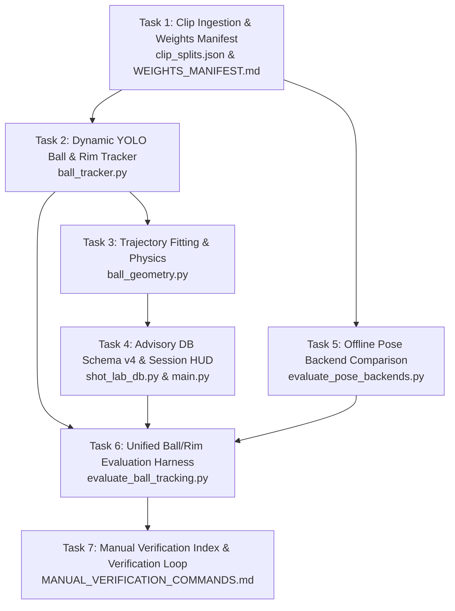

# Phase 7 — Ball, Rim, and Trajectory Tracking: Implementation Plan

**Status:** Ready for Execution (Context locked in `07-CONTEXT.md`)  
**Goal:** Deliver ball and rim detection, shot-synchronized trajectory physics, advisory automated outcome qualification, and an offline MediaPipe vs. YOLO Pose comparative experiment.

---

## 1. Executive Summary & Architectural Decisions

1. **Strict Scope Boundary:**
   - Focus is exclusively on ball/rim object detection, post-release trajectory parabola fitting, advisory make/miss evidence, and experimental offline pose comparison.
   - End-user mobile app UI/UX is strictly deferred to **Phase 8**.
   - Final academic release packaging and viva demo materials are deferred to **Phase 9**.
2. **Model Weights Governance (Decision 1):**
   - External model weights remain in `models/` under their original filenames:
     - Primary ball/rim detector: `models/best.pt` (6.25 MB, YOLOv8n, trained on `Basketball.v1i.yolov8`).
     - Pose comparison model: `models/yolov8m-pose.pt` (53.2 MB, YOLOv8m-pose).
     - Heavyweight alternative: `models/ballRim.pt` (22.5 MB).
   - Scripts support a configurable `--weights` path (defaulting to `models/best.pt`). No copying or renaming of model files until formally validated.
   - Provenance, licenses, SHA256 checksums, and class maps are recorded in `WEIGHTS_MANIFEST.md`.
3. **Dynamic Class Mapping (Decision 2):**
   - In `ball_tracker.py`, classes are dynamically resolved from `model.names` (inspecting class labels for `ball`, `basketball`, `rim`, `hoop`, `basket`) rather than hardcoded integer indices.
   - Graceful fallback: missing weights or missing dependencies emit `UNAVAILABLE_NO_WEIGHTS` instead of crashing.
4. **Advisory Outcome Storage & Human Ground Truth Inviolability (Decision 3):**
   - MediaPipe remains the primary engine for biomechanics measurements.
   - Schema v4 in `shot_lab_db.py` introduces dedicated shadow/advisory columns (`automated_outcome`, `automated_outcome_conf`, `trajectory_fit_r2`, `entry_angle_deg`, `ball_coverage_ratio`).
   - Human `shots.outcome` (`M`/`X`/`U`) remains immutable ground truth; automated classification never overwrites human labels and is never admitted to personal baselines automatically.
5. **Experimental Offline Pose Backend Benchmark (Decision 4):**
   - Dedicated script `evaluate_pose_backends.py` compares MediaPipe Tasks Pose vs. YOLO Pose (`models/yolov8m-pose.pt`) on shared joints (shoulders, elbows, wrists, hips, knees, ankles).
   - Evaluates joint completeness %, dropout rate during fast release motion, and estimate-to-estimate distance without slowing down live inference.
6. **Dual-Track Evaluation Harness (Decision 5):**
   - Unified harness `evaluate_ball_tracking.py` outputs audit-compliant `BALL_RIM_EVAL_REPORT.json` per `AGENTS.md`:
     - **Part A:** Object detection mAP@50, Precision, and Recall on `Basketball.v1i.yolov8/test` (472 images).
     - **Part B:** Shot-synchronized ball tracking, coverage %, and trajectory fit $R^2$ on project validation footage (`raw_clips/`).
     - **Part C:** Joint agreement distribution between MediaPipe and YOLO Pose.

---

## 2. Work Breakdown & Task Sequence



---

### Task 1: Clip Ingestion & Weights Manifest

- **Objective:** Register the 8 newly added raw clips in `clip_splits.json` and `shot_lab_db.py`, document all model weights in `WEIGHTS_MANIFEST.md` with SHA256 hashes and licenses, and verify zero split leakage.
- **Files to create/modify:**
  - Create: `WEIGHTS_MANIFEST.md`
  - Modify: `clip_splits.json`, `batch_ingest_clips.py`
  - Create: `test_weights_manifest.py`
- **Detailed Specification:**
  1. Inspect the 8 new clips in `raw_clips/` (`20521284-uhd_2160_3840_60fps.mp4`, `4964842-hd_1080_1920_25fps.mp4`, `5275080-uhd_2160_4096_25fps.mp4`, and 5 `mixkit-*.mp4` clips).
  2. Assign canonical IDs and splits in `clip_splits.json`:
     - Stock / Mixkit clips with visible hoops allocated to `train` and `val` for tracking experiments.
     - Add `mixkit_shooter` and `stock_shooter` to `PLAYER_REGISTRY` in `batch_ingest_clips.py`.
  3. Generate `WEIGHTS_MANIFEST.md` recording:
     - `models/best.pt`: SHA256 checksum, source (`Basketball.v1i.yolov8`), classes (`basketball`, `rim`, `sports ball`), CC BY 4.0.
     - `models/ballRim.pt`: SHA256 checksum, source (`Basket2-7`), classes (`Basketball`, `Rim`).
     - `models/yolov8m-pose.pt`: SHA256 checksum, source (Ultralytics), 17 keypoints.
     - `models/bestYT.pt`: SHA256 checksum, source (MSDS_692 capstone), 8 classes.
  4. Ensure `batch_ingest_clips.py` successfully ingests all 23 clips.
- **Verification:**
  - Unit tests in `test_weights_manifest.py` verifying file hashes, class parsing, and split config integrity.

---

### Task 2: Dynamic Ball & Rim YOLO Tracker (`ball_tracker.py`)

- **Objective:** Refactor `load_yolo()` and `BallTracker` in `ball_tracker.py` to support dynamic class mapping, configurable `--weights`, and robust fallback handling.
- **Files to create/modify:**
  - Modify: `ball_tracker.py`
  - Create: `test_ball_tracker.py`
- **Detailed Specification:**
  1. `load_yolo(weights_path=None)`:
     - Check `weights_path` if passed, or default to `models/best.pt`.
     - Dynamically inspect `model.names`:
       ```python
       ball_classes = [idx for idx, name in model.names.items() if any(k in name.lower() for k in ["ball", "basketball"])]
       rim_classes = [idx for idx, name in model.names.items() if any(k in name.lower() for k in ["rim", "hoop", "basket"])]
       ```
     - Return `(model, class_map)` where `class_map = {"ball": ball_classes, "rim": rim_classes}`.
  2. Implement graceful degradation:
     - If `weights_path` does not exist or `ultralytics` fails to load, set `self.rim_status = "UNAVAILABLE_NO_WEIGHTS"`.
     - In stub/unavailable mode, `step()` returns empty detections without raising uncaught exceptions.
  3. Shot lifecycle synchronization:
     - Synchronize with pose detector hooks: `on_shot_started(shot_id, frame_idx)`, `on_shot_release(shot_id, frame_idx, timestamp_ms)`, `on_shot_ended(shot_id, frame_idx)`.
     - Collect ball centers strictly between release frame and shot termination.
- **Verification:**
  - Automated unit tests in `test_ball_tracker.py` covering dynamic class resolution, custom vs. COCO fallback, and lifecycle hook isolation.

---

### Task 3: Trajectory Fitting, Geometry & Physics (`ball_geometry.py`)

- **Objective:** Enhance parabola fitting, release angle, and entry angle calculations in `ball_geometry.py` with rigorous numerical validation and minimum sample gating.
- **Files to create/modify:**
  - Modify: `ball_geometry.py`
  - Create: `test_ball_geometry.py`
- **Detailed Specification:**
  1. `fit_parabola(points)`:
     - Fit $y(x) = a x^2 + b x + c$ using least-squares polynomial regression.
     - Compute coefficient of determination $R^2 = 1 - \frac{\sum (y_i - \hat{y}_i)^2}{\sum (y_i - \bar{y})^2}$.
     - Verify inverted U-shape in screen coordinates ($a > 0$ since $y$ increases downward).
     - Return `{"a": a, "b": b, "c": c, "r2": r2, "apex": (x_apex, y_apex)}`.
  2. Gating and evidence limits:
     - Require $N \ge 4$ post-release ball detections. If $N < 4$, return `status: INSUFFICIENT_POINTS`.
     - If $R^2 < 0.70$, flag as `POOR_FIT`.
  3. Launch and Entry Angles:
     - `calculate_release_angle(pt0, pt1)`: tangent angle of trajectory at release relative to horizontal.
     - `calculate_entry_angle(parabola, rim_box)`: arrival trajectory angle at rim elevation.
  4. Rim Proximity & Advisory Outcome:
     - Compute minimum distance between fitted trajectory / detected ball and rim center.
     - If ball passes below rim within rim width bounds after apex, classify advisory `make`; if misses rim boundary or rebounds, classify advisory `miss`.
- **Verification:**
  - Automated tests in `test_ball_geometry.py` with synthetic parabolic trajectories, noisy points, and edge cases.

---

### Task 4: Advisory Database Schema v4 & Session Pipeline Integration

- **Objective:** Extend `shot_lab_db.py` to schema v4 with advisory ball/rim columns, preserving human ground truth, and connect ball tracking into `main.py`.
- **Files to create/modify:**
  - Modify: `shot_lab_db.py` (Schema v4)
  - Modify: `main.py`
  - Create: `test_ball_tracking_flow.py`
- **Detailed Specification:**
  1. `shot_lab_db.py` Schema Version 4:
     - Automatic migration adding advisory columns to `shots` table:
       - `automated_outcome TEXT DEFAULT 'unknown'`
       - `automated_outcome_conf REAL`
       - `trajectory_fit_r2 REAL`
       - `entry_angle_deg REAL`
       - `ball_coverage_ratio REAL`
       - `ball_model_version TEXT`
     - Retain `outcome` (`make`, `miss`, `unknown`) strictly as human-verified ground truth.
     - Enforce rule: automated outcomes cannot overwrite human `outcome` and cannot admit shots to baseline calculations.
  2. `main.py` CLI & Runtime:
     - Add `--weights` argument (default `models/best.pt`).
     - When `--ball` is active, initialize `BallTracker(weights_path=args.weights)`.
     - Pass shot start/release/end events from `ShotPhaseDetector` / `CalibratedFSMDetector` to `BallTracker`.
     - Render advisory flight trajectory arc and launch/entry angle toast on the HUD overlay.
- **Verification:**
  - End-to-end integration test `test_ball_tracking_flow.py` running saved video processing with `--ball` and asserting advisory DB fields are populated.

---

### Task 5: Offline Pose Backend Comparative Experiment (`evaluate_pose_backends.py`)

- **Objective:** Build an offline evaluation tool comparing MediaPipe Tasks Pose with YOLOv8 Pose (`models/yolov8m-pose.pt`) on validation clips.
- **Files to create/modify:**
  - Create: `evaluate_pose_backends.py`
  - Create: `test_pose_backend_comparison.py`
- **Detailed Specification:**
  1. Load MediaPipe Tasks Pose (`pose_landmarker.task`) and YOLOv8 Pose (`models/yolov8m-pose.pt`).
  2. Process validation clips frame-by-frame and extract 12 shared joints:
     - `left_shoulder`, `right_shoulder`, `left_elbow`, `right_elbow`, `left_wrist`, `right_wrist`
     - `left_hip`, `right_hip`, `left_knee`, `right_knee`, `left_ankle`, `right_ankle`
  3. Compute comparative metrics:
     - Joint detection rate (% frames with confidence $> 0.5$).
     - Average Euclidean distance between estimates (normalized by torso height).
     - Stability during keyframe releases (variance of wrist vertical velocity).
     - Dropout rate during fast motion and occlusions.
  4. Generate `POSE_BACKEND_COMPARISON_REPORT.json` documenting comparative findings without declaring either model as ground truth.
- **Verification:**
  - Automated tests in `test_pose_backend_comparison.py` verifying joint mapping, distance calculation, and report structure.

---

### Task 6: Unified Ball/Rim Evaluation Harness & Audit Report (`evaluate_ball_tracking.py`)

- **Objective:** Build a unified benchmark harness evaluating `models/best.pt` on both the Roboflow test set and project raw clips, emitting `BALL_RIM_EVAL_REPORT.json`.
- **Files to create/modify:**
  - Create: `evaluate_ball_tracking.py`
  - Create: `test_evaluate_ball_tracking.py`
- **Detailed Specification:**
  1. **Part A (Dataset Object Detection Benchmark):**
     - Run `models/best.pt` on `Basketball.v1i.yolov8/test` (472 images) using Ultralytics validation API.
     - Record Precision, Recall, and mAP@50 for classes `basketball` and `rim`.
  2. **Part B (Project Video Tracking Benchmark):**
     - Run on project validation clips in `raw_clips/` (including clips with visible hoops).
     - Record average ball detection coverage % during shot intervals, mean trajectory fit $R^2$, and rim proximity detection rate.
  3. **Part C (Provenance & Reporting):**
     - Output audit-compliant `BALL_RIM_EVAL_REPORT.json` recording code commit, weights SHA256, test set size, and metric values.
- **Verification:**
  - Automated tests in `test_evaluate_ball_tracking.py` validating report generation and integrity schema.

---

### Task 7: Manual Verification Index & Verification Loop

- **Objective:** Update `MANUAL_VERIFICATION_COMMANDS.md` with canonical commands for Phase 7, run all unit and integration test suites, and update `graphify` knowledge graph.
- **Files to create/modify:**
  - Modify: `MANUAL_VERIFICATION_COMMANDS.md`
  - Modify: `.planning/STATE.md`
- **Detailed Specification:**
  1. Add Phase 7 commands to `MANUAL_VERIFICATION_COMMANDS.md`:
     - Live & clip execution with `--ball --weights models/best.pt`
     - Running offline pose comparison: `.venv\Scripts\python.exe evaluate_pose_backends.py`
     - Running unified Phase 7 benchmark: `.venv\Scripts\python.exe evaluate_ball_tracking.py`
  2. Run the complete test suite across all modules (Phase 1–7) ensuring 0 failures.
  3. Rebuild knowledge graph: `.venv\Scripts\python.exe -m graphify update .`.
- **Verification:**
  - All test commands exit with code 0.

---

## 3. Success Criteria & Phase 7 Exit Gate

1. **Model & Tracking Integrity:** `models/best.pt` correctly loads, detects `basketball` and `rim` via dynamic class resolution, and fits trajectories post-release.
2. **Advisory Separation:** Automated make/miss is persisted in advisory DB fields; human `shots.outcome` is never overwritten.
3. **Empirical Pose Benchmark:** MediaPipe vs. YOLO Pose comparison produces clear, data-driven report `POSE_BACKEND_COMPARISON_REPORT.json`.
4. **Reproducible Report:** `BALL_RIM_EVAL_REPORT.json` documents real mAP scores on `Basketball.v1i.yolov8/test` and trajectory coverage on project clips.
5. **Zero Regression:** All existing test suites pass with 100% success rate.
