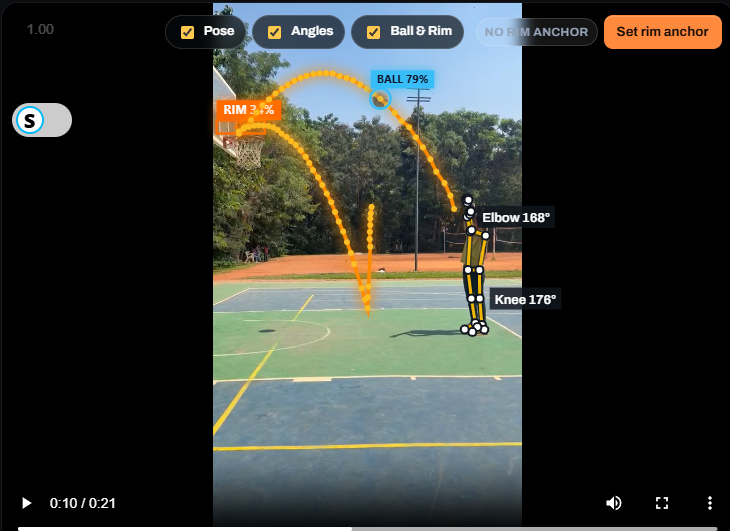
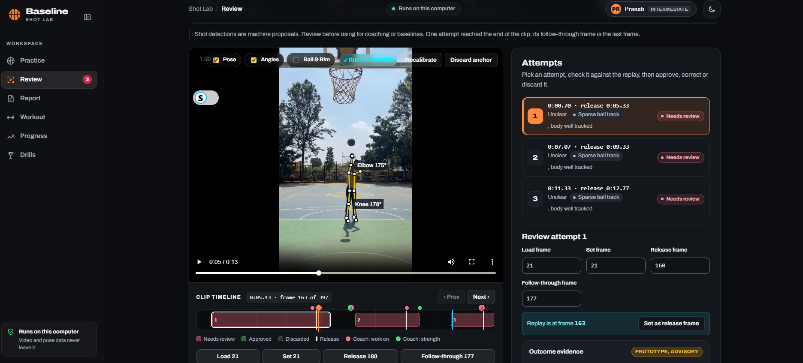
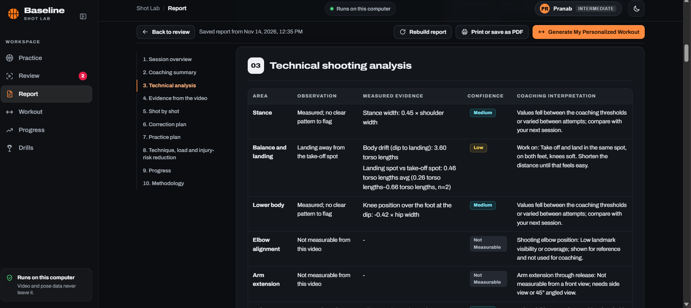
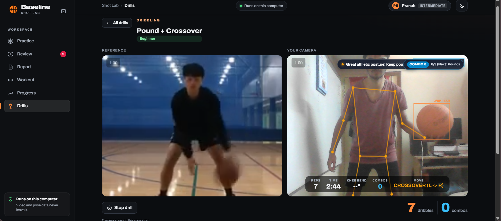
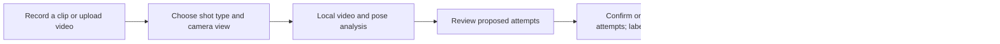

# Baseline Shot Lab

**Baseline Shot Lab is a local-first basketball practice and shooting-analysis app.** Record a session with your camera or upload a practice video, review the shot attempts it detects, and get a report with measured technique, coaching priorities, and drills to practise.

It is designed for players and coaches who want a clearer view of a practice session. The browser app runs on your computer; video analysis and storage stay local. Pose estimates and coaching suggestions are useful training aids, not a substitute for a coach's judgement or medical advice.

## What you can do

- **Analyze shooting practice:** Upload a clip or record from a camera, choose the shot and camera view, then let Shot Lab estimate pose and propose shot attempts.
- **Review attempts yourself:** Check the proposed attempts and replay their video. Confirm or discard them, and label makes or misses yourself. Shot outcome is not decided for you.
- **Explore your results:** View measurable biomechanics, consistency and session findings. Metrics that cannot be reliably measured from the clip may be marked unavailable.
- **Get coaching guidance:** Read a session report with strengths, improvement priorities and practice suggestions. Where available, create a personalized workout and ask the optional AI coach questions about the session.
- **Practise dribbling:** Use the Drills area for video-guided drills, a camera-based rep counter and basic pace/rhythm feedback.
- **Track sessions:** Revisit saved sessions and view progress over time.

## See the app

<table>
  <tr>
    <td><strong>Practice analysis</strong><br></td>
    <td><strong>Attempt review</strong><br></td>
  </tr>
  <tr>
    <td><strong>Coaching report</strong><br></td>
    <td><strong>Drill practice</strong><br></td>
  </tr>
</table>

## How a session works



### A good first session

1. Start the web app and open it in a browser on the same computer.
2. In **Practice**, select the shot type, shot style and camera view that match your clip.
3. Record a short clip or upload a video. Keep your full body and the ball visible; a steady side-on or 45-degree camera angle is a useful starting point.
4. Start analysis and wait for processing to finish.
5. Open **Review**. Check each proposed attempt, discard false detections, and confirm the attempts you want included. Add make/miss labels based on what you see in the video.
6. Open **Report** to read the session findings and suggestions. Use **Progress** to revisit previous sessions. Dribbling practice is available separately under **Drills**.

Analysis quality depends on camera placement, lighting, visibility, and the movement being filmed. Single-camera pose and biomechanics are estimates. Shot attempts are proposals and should be reviewed before you rely on the report.

## Run Shot Lab

### Requirements

- Python 3.9 or newer (as specified by the package metadata).
- A modern desktop browser.
- The repository's model assets are needed for video analysis. They are included in the project checkout; no external dataset is required for normal use.

### Install and start

From the project directory, create and activate a virtual environment if desired, then install the project dependencies:

```powershell
python -m pip install -e .
python web_app.py --port 8000
```

Open [http://127.0.0.1:8000](http://127.0.0.1:8000) in your browser. Stop the server with **Ctrl+C** in the terminal.

To use the desktop HUD with a video file instead, see the command examples in [Manual Verification Commands](docs/reference/MANUAL_VERIFICATION_COMMANDS.md).

### Use a phone camera over Wi-Fi

Uploading a video from your phone works over a normal local network connection. Live camera access from a phone browser requires HTTPS. Shot Lab can provide local HTTPS and a phone setup page:

```powershell
python -m pip install cryptography
python web_app.py --lan --https
```

Follow the address and setup instructions printed by the server. The phone and computer must be on the same trusted Wi-Fi network. The first setup requires installing and trusting Shot Lab's local certificate on the phone; see [Phone camera over Wi-Fi](#phone-camera-over-wi-fi-https) in the detailed setup notes below.

<details id="phone-camera-over-wi-fi-https">
<summary>Phone camera over Wi-Fi (HTTPS) setup details</summary>

The terminal prints the HTTPS app address, an access code, a phone setup page, and the certificate fingerprint. Use the setup page to download the public certificate, then install and trust it in the phone's system settings. Open the HTTPS address, enter the access code, choose **Record with camera**, and allow camera access. Do not bypass browser certificate warnings.

- On iPhone/iPad, install the downloaded profile in **Settings → General → VPN & Device Management**, then enable trust in **Settings → General → About → Certificate Trust Settings**.
- On Android, install it as a CA certificate in the device's security settings.
- Keep the phone screen awake while recording. Camera access requires a secure browser context; video uploads do not.

See the server's printed setup instructions and camera diagnostics if your device or browser uses different menu names.
</details>

## Privacy and optional AI coach

Video decoding, pose estimation, and report generation run on the computer hosting Shot Lab. The AI coach is optional and requires provider API keys. When enabled, it sends session text summaries to the configured provider; video, frames and pose landmarks are not sent. Do not enable it if you do not want session summaries sent to an external service. See `.env.example` for the supported settings and keep real keys in the ignored `.env` file.

The web server is intended for local use. If you enable LAN access, keep it on a trusted private network and use the access code and HTTPS instructions provided by the app.

## Project notes

Shot Lab focuses on evidence-backed feedback: findings are based on recorded measurements and attempt review, and uncertain or unmeasurable results should be treated cautiously. It does not diagnose injuries or calculate a medical injury-risk score.

The application is built in Python, with a browser interface, local video/pose processing and SQLite session storage. The web entry point is `web_app.py`; the desktop HUD entry point is `main.py`. For architecture, data handling, evaluation and development commands, see [Manual Verification Commands](docs/reference/MANUAL_VERIFICATION_COMMANDS.md) and the source tree under `src/basketball/`.

### Project team

BCS506 Major Project, B.E. Information Science & Engineering, VTU — BMS Institute of Technology & Management, Bengaluru (2025–26).

- Pranab Bhardwaj — vision, architecture and tracking
- Pavan R Bhat — kinematics and shot-phase detection
- Pracheth Kashyap — recording, database and dataset export
- Puneetgouda Patil — coaching rules and output interface
